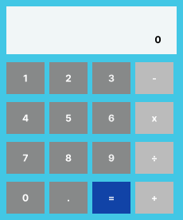

# EE471 Week 4

## Section 1: Calculator

### Part 1: Figma Design

Figma link (view only): [https://www.figma.com/design/7uICXiUTAUPA9aP56P94VV/Untitled?node-id=2-3&t=D9lBnFyXcNEeXvBY-0]

### Part 2: Web calculator with Flask

Run:
    source .venv/bin/activate
    cd calculator
    python3 app.py
Then open http://localhost:5001

API: `POST /api/calculate`
- Request: `{"a": 10, "b": 5, "operation": "add"}` (add, subtract, multiply, divide)
- Success (200): `{"result": 15}`
- Error (400): `{"error": "Cannot divide by zero."}`

All calculations run on the server with the Calculator class. No eval() is used.

## Section 2: Library

Part 1 (Figma design) was a bonus and was skipped; the frontend was built from a written layout (see library/PROMPTS.md).

Run:
    source .venv/bin/activate
    cd library
    python3 app.py
Then open http://localhost:5001

API: `/api/items` (GET, POST), `/api/items/<id>` (GET, PUT, PATCH, DELETE),
`/api/items/<id>/checkout` and `/api/items/<id>/return` (POST).
Errors are JSON: `{"error": "..."}` with 400, 404 or 409.